# AVA X-COM

[](https://github.com/Harlock123/AVAXCom/actions/workflows/build.yml)

A turn-based strategy game in the style of MicroProse and Mythos Games' 1994 **X-COM: UFO Defense** (*UFO: Enemy
Unknown*), built with .NET 10 and Avalonia UI. In the game it is called **Vigil: The Silent Invasion**, with names of
its own (see [About and licence](#about-and-licence)). The aliens have come, and the nations of the Earth have funded
one organisation, **Vigil**, to stop them. Build a base, track the UFOs on a turning globe, shoot them down, send
squads to the crash sites, take the aliens' weapons and their secrets back to your laboratories, and keep the funding
council happy month after month, until you know enough to carry the war to the aliens' own world.

There are two halves to it, as there were in the original: **the geoscape**, a real-time view of the whole Earth where
the war is run, and **the battlescape**, turn-based squad tactics on an isometric map several storeys high.

## Features

### The geoscape

- **The globe** turns under your mouse (drag it, or the arrows) and zooms in five steps. It is painted pixel by pixel
  from a small embedded land mask (72 by 36 cells of five degrees, smoothed and roughened so the coasts wander): seas
  shallow and deep, land coloured by climate (ice, tundra, forest, farmland, desert, jungle) with mountains, the day and
  night sides divided by a soft terminator that moves with the time of day and the season, the night side lit by its
  cities, a sun glint on the sea and a blue rim of atmosphere. Sixteen funding nations and nearly fifty cities are marked.
- **Time** runs at six speeds, from five seconds to a day, and stops for anything that needs you: a UFO found, an
  interception, a craft at a site, research or manufacturing finished, a terror site, a base attacked, the monthly
  report. Quieter news (arrivals, finished buildings, craft home) scrolls along the bottom.
- **Bases** are laid out on a six-by-six grid: the access lift first, and every facility after it joined to the rest.
  Hangars (two by two, one craft each), living quarters, laboratories, workshops, general stores, alien containment,
  small and large radars, missile, laser and storm defences, a grav shield, a mind shield, a signal decoder and a psi lab,
  each drawn from above in its own art, with days to build and a monthly upkeep. Facilities can be pulled down if
  nothing is cut off and nothing is left without room. Up to six bases.
- **Radar** finds UFOs within each base's range (better with a large radar or the signal decoder, which also tells
  their type, crew and mission) and within 600 nautical miles of any craft in the air; contact is lost when they fly
  out of range.
- **The aliens' plans**: UFOs from the little Seeker to the Dreadnought fly scouting, research, abduction and harvest
  missions, land for a few hours (a landed UFO can be assaulted), start terror sites in cities, build alien bases, supply
  them, and, once you've hurt them enough, come for one of your bases. Each month brings more of them, bigger, and
  crewed by worse things.
- **Interception**: launch a Falcon at a UFO and it chases it on the globe; when it catches it, the air battle opens in
  a window of its own. Choose **standoff**, **cautious** (fire at your longest weapon's range), **standard**,
  **aggressive** (close in: better aim, but in the UFO's reach) or **disengage**. Lancer missiles, the autocannon, the
  laser cannon and the storm beam have their own ranges, damage, rates of fire and ammunition. A UFO hurt past half its
  strength crash-lands (a crash site, if it comes down on land); past all of it, it's blown apart. Craft come home to be
  repaired, rearmed from the stores and refuelled, and turn back short of fuel.
- **Research**: forty-two topics in a tree. Laser weapons from the start; autopsies of every race's corpse;
  interrogations of live captives (alien containment needed); the aliens' own **storm** weapons and grenades;
  **vorium** (the aliens' power crystal), **hullmetal**, the drive core and the nav lattice; carapace armour and the
  strider suit; the grav drive (the Vantage strike craft), base defences and shields, psionics; and at the end of the
  road, *Alien Origins*, *The Homeworld* and the *Starfall*, the only craft that can reach the aliens' world. Specimens
  and captives are used up by the work.
- **Manufacturing**: twenty projects, each with engineer-hours, a price and alien materials per unit; the finished items
  go to the stores (or the hangar). **Selling** turns alien finds into money.
- **Staff**: hire soldiers, scientists and engineers (they arrive in three days); buy weapons, ammunition, craft
  weapons and craft. Wages and upkeep are paid at the month's end.
- **Soldiers** have names and nationalities, time units, health, reactions, firing and throwing accuracy, strength,
  bravery and (once a psi lab has found it) psionic strength and skill. Their numbers grow with what they do on a
  mission (hits, reaction shots, throws, psionics, coming through fire), and they rise from rookie through squaddie,
  sergeant, captain and colonel to commander. Choose each one's armour and weapon and which craft they fly in. The
  wounded spend days recovering. The dead stay dead, and go on the **memorial**.
- **The council** reports at every month's end: the month's score (Vigil's points less the aliens'), a rating from
  terrible to excellent, and each nation's funding up or down by how it was served. An unhappy nation withdraws; one
  with an alien base on its soil may sign a pact with the aliens.
- **Winning and losing**: research your way to *The Homeworld*, build the Starfall, and send it with a squad through
  the gate to Nyx to destroy the hive mind. You lose if the council terminates the project (two terrible months running,
  two months in debt, or half the nations gone) or your last base falls.

### The battlescape

- **The map** is forty tiles square and four storeys high, seen in isometric view, each tile with its floor, a wall on
  its west and north edges and something standing in it, as in the original. It's made for each mission: **farmland**
  with fields of tall crops behind hedges with gaps, a two-storey farmhouse and a barn; a **city** of streets, cars and
  shops two storeys high with windows and stairs; **forest**, **desert** and **arctic** ground; an **alien base** carved
  out of rock; the **hive of Nyx**; and **your own base**, laid out room by room from its facilities when the aliens come
  for it. The **transport** sits at the map's edge with its ramp down, the squad aboard.
- **The UFO** is a building of its own: a disc of glowing deck walled with hull, a door facing the transport, an inner
  chamber round the drive core with the nav lattice up front, consoles and pods, and in the big ones a second deck
  reached by a gravity lift. A crashed UFO has holes torn in its hull, wreckage strewn about, and fewer survivors.
- **Time units**: four a straight step, six a diagonal, more through crops, rubble and doors, eight up stairs; one for
  each eighth of a turn; four to kneel and eight to stand. Each weapon fires **snap**, **aimed** or **auto** (a burst
  of three), each with its accuracy and its cost as a share of the soldier's time units, and the chance to hit shows
  under the cursor: better kneeling, worse with a two-handed weapon and something in the other hand, worse with wounded
  arms and at long range. A missed shot flies on and may hit something (or someone) else.
- **Sight and the fog**: everyone sees in a ninety-degree cone. Walls, hedges, trees, crops and floors block sight
  (fences and windows don't), from storey to storey as well as across; what has been seen stays remembered, dimmed.
  **At night** the squad sees only nine tiles except where it's lit (by **flares**, the glowing decks of UFOs and the like),
  while the aliens see in the dark.
- **The aliens' turn** is **hidden movement** unless you can see them; their minds share what any of them has seen,
  advance on what they know of, shoot (aimed when there's time, a burst up close), grenade a huddle, guard
  their UFO, and reach into minds.
- **Reaction fire**: anyone with time units for a snap shot may interrupt an enemy who moves or fires in sight, if
  their reactions (scaled by the time units they have left) beat the mover's.
- **Grenades** are primed in hand to go off at the end of the turn or one, two or more turns later, then thrown (as far
  as strength and weight allow, as near the mark as the throwing accuracy allows), arcing over low things.
  **Explosions** knock down walls, floors and trees; those on a floor that's gone fall to the one below; fuel drums and
  drive cores blow up.
- **Damage** is half to one and a half times a weapon's power, less the armour it meets (front, sides, rear, or
  underneath for a blast). Heavy hits open **fatal wounds** that bleed every turn until a **field kit** treats them;
  its stimulants wake the stunned and its painkillers steady the frightened. A **shock baton** or a stun bomb knocks an
  alien out to be taken alive.
- **Morale**: every death shakes a side (the timid most, less under a high-ranking officer); wounds frighten; kills
  hearten. Below half, a soldier may **panic** (freeze, dropping their weapon) or go **berserk** (firing at whoever is
  nearest).
- **The inventory**: two hands, a belt of four small things, a backpack of six spaces, and the ground. Moving things
  about costs time units (free aboard the transport on the first turn), reloading takes fifteen, and what weighs more
  than a soldier's strength costs time units every turn.
- **The aliens**, each with its own look and ways: the **Pallid**, frail and big-headed, whose leaders have the gift;
  the **Skimmer**, a torso on a jet harness that flies over walls; the **Coilback**, slow, tough and fond of grenades;
  the **Brakk**, hulking shock troops; the **Veiled**, robed and faceless, the minds behind the invasion, who panic and
  take over soldiers; the **Husker**, a six-limbed horror whose victims rise as **Husks**, from which a new Husker breaks
  free when they fall; and the **Warden**, a hovering lens of armour with a storm projector in its rim, which bursts
  when destroyed.
- **The debrief**: aliens killed and captured, the UFO and its artefacts recovered (hullmetal from its hull, drive
  cores with their vorium, the nav lattice), civilians saved and lost, soldiers lost, each line with its points; the
  finds go to the stores and the captives to containment. Abort a mission and only those aboard the transport come home.

### And

- **The demonstration**: left at the title, the game plays itself: a little of the geoscape (a UFO found, an
  interceptor launched, the air battle), then a ground mission with the pilot leading the squad.
- **The campaign** is saved in six slots and an automatic one (after every mission, at every month's end), and can be
  continued from the title. The campaign's score goes on the roll of honour with your initials.

## Screenshots

| The title | The geoscape | An interception |
|:---------:|:------------:|:---------------:|
| 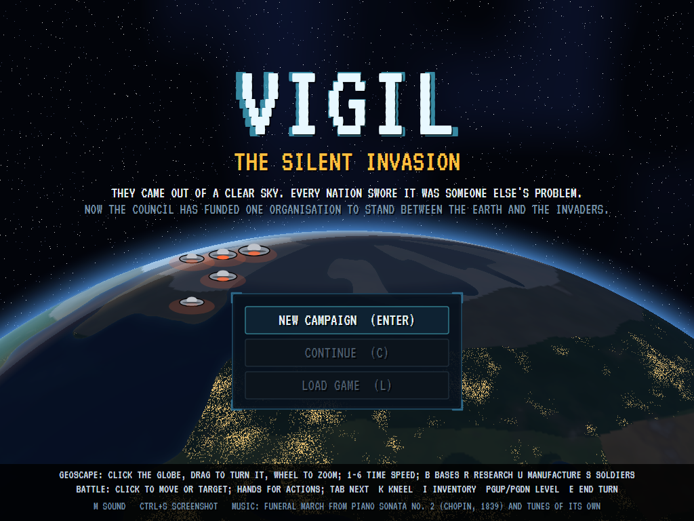 | 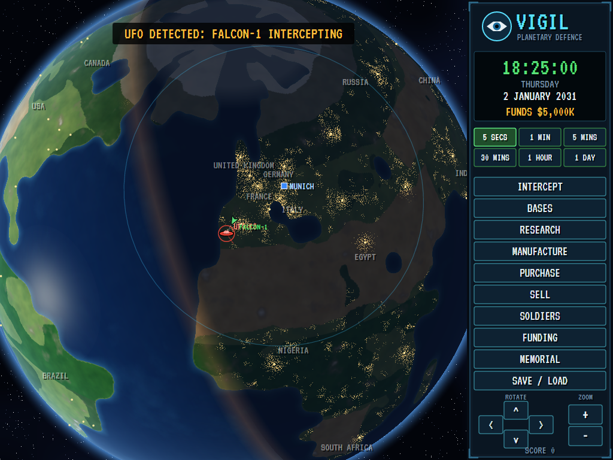 | 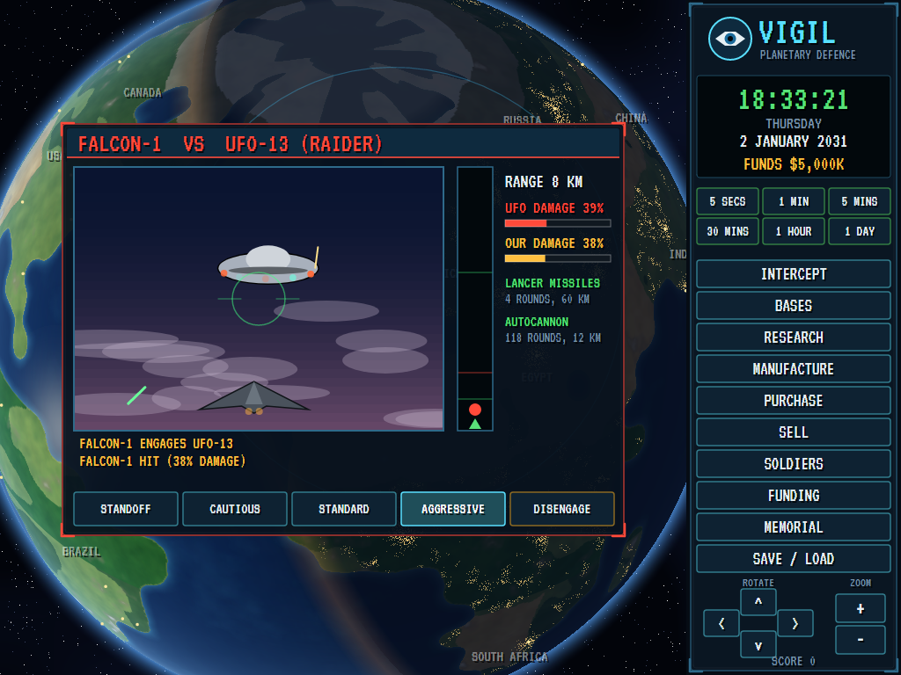 |
| Vigil: The Silent Invasion. | A Falcon chases a UFO over the Atlantic at nightfall. | Aggressive: in close with missiles and cannon. |

| A base | Research | Deployment |
|:------:|:--------:|:----------:|
| 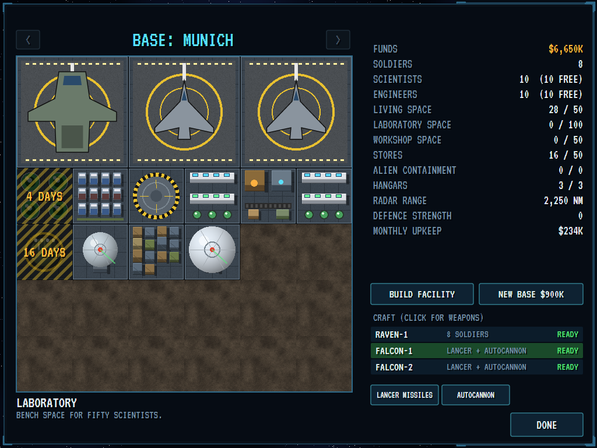 | 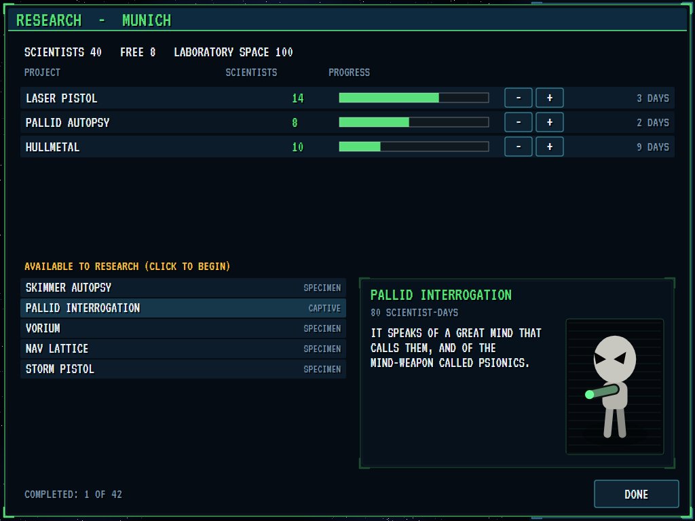 | 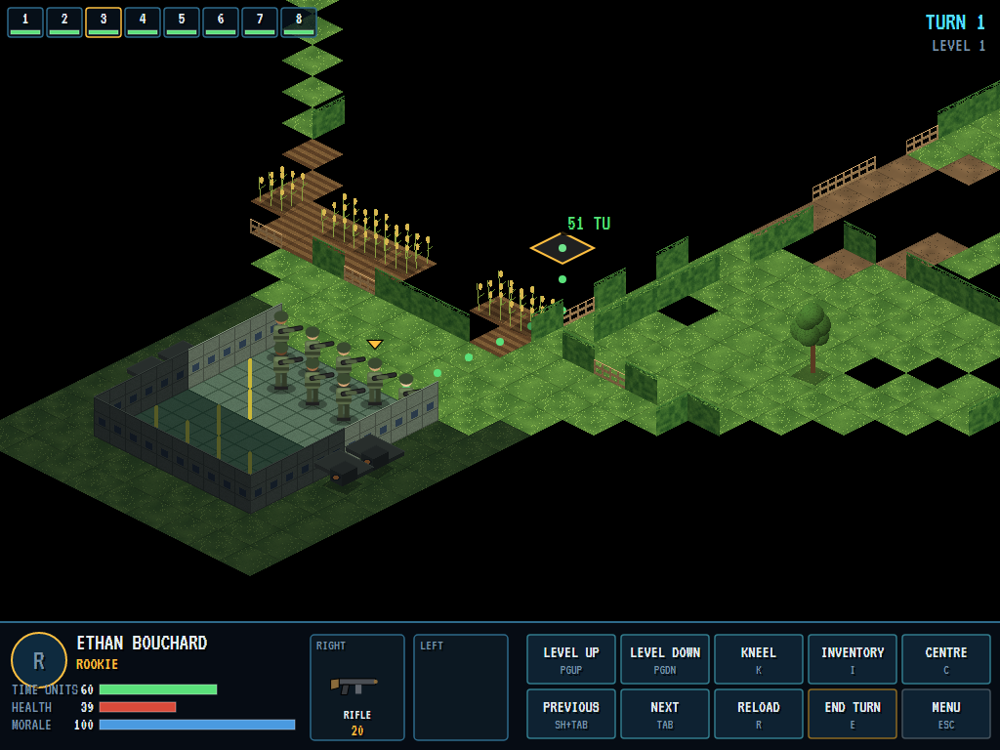 |
| Hangars, labs, radar, and more being dug. | Lasers and an autopsy on the benches. | The ramp is down. |

| A firefight | An explosion | The inventory |
|:-----------:|:------------:|:-------------:|
| 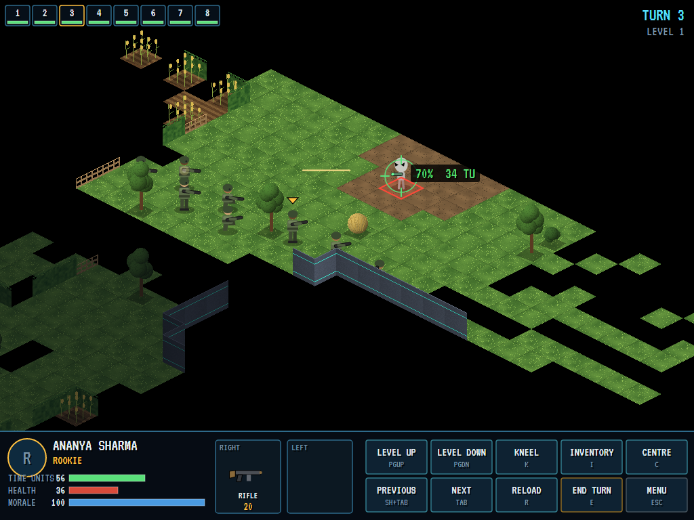 | 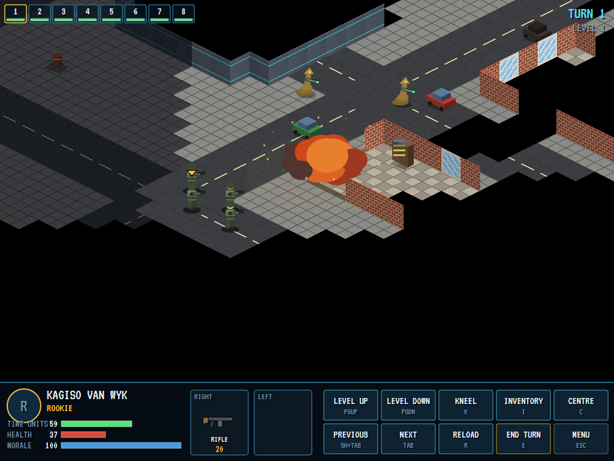 | 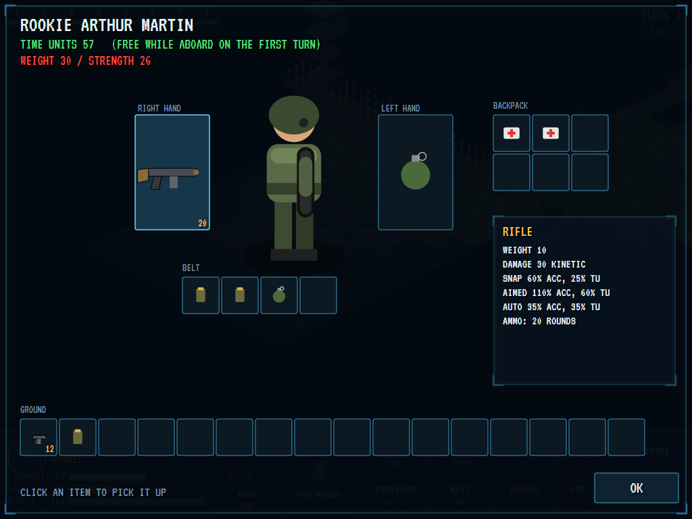 |
| An aimed shot at a Pallid: 70% to hit. | A grenade against a house wall in the city. | Hands, belt, backpack and ground. |

| The debrief | The roll of honour |
|:-----------:|:------------------:|
| 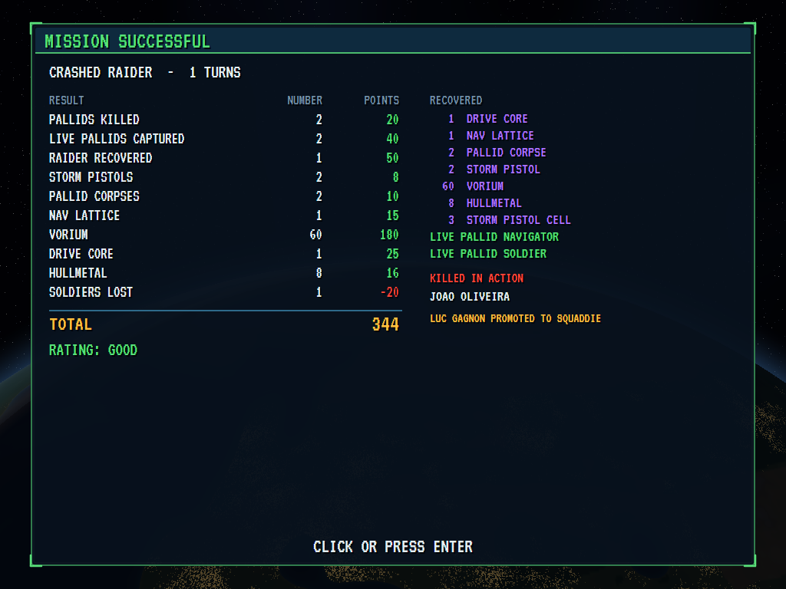 | 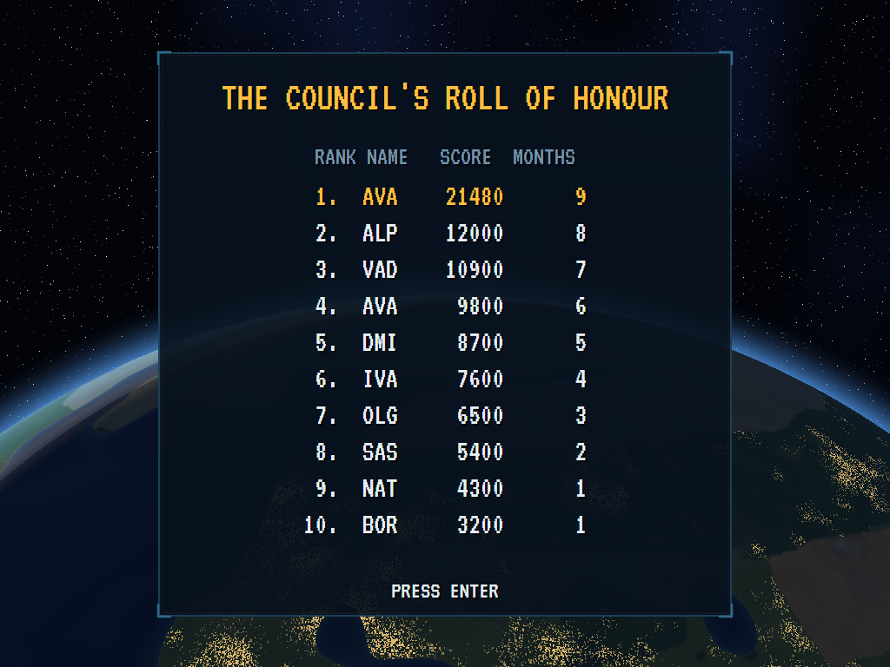 |
| A crashed Raider recovered, two Pallids alive. | The high scores. |

The screenshots are made by the tests, which play the game in a real (headless) window; see [Tests](#tests).

## Download and run

Ready-to-run builds for Windows, macOS and Linux, on both Intel/AMD and ARM, are on the
[Releases page](https://github.com/Harlock123/AVAXCom/releases/tag/latest). **Latest build** is rebuilt on every push
to `main`. Each download is one self-contained executable: no .NET install is needed.

| Platform | Archive |
|---|---|
| Windows | `AVAXCom-win-x64.zip`, `AVAXCom-win-x86.zip`, `AVAXCom-win-arm64.zip` |
| macOS | `AVAXCom-osx-arm64.tar.gz` (Apple silicon), `AVAXCom-osx-x64.tar.gz` (Intel) |
| Linux | `AVAXCom-linux-x64.tar.gz`, `AVAXCom-linux-arm64.tar.gz`, `AVAXCom-linux-arm.tar.gz` |

```bash
tar -xzf AVAXCom-linux-x64.tar.gz     # or linux-arm64, linux-arm, osx-arm64, osx-x64
./AVAXCom
```

On Windows, unzip and run `AVAXCom.exe`. On macOS, if Gatekeeper refuses to open it, run
`xattr -d com.apple.quarantine AVAXCom` once. Run with `--no-audio` for silence.

**Sound** comes through OpenAL Soft, built in for every platform. In a virtual machine the game detects it and uses a
larger audio buffer, so the sound doesn't break up.

**Gamepads** use SDL2, which is bundled for Windows, macOS and Intel/AMD Linux. ARM Linux builds need it installed;
without it the keyboard and mouse still work:

```bash
sudo apt install libsdl2-dev            # Debian / Ubuntu / Raspberry Pi OS
sudo pacman -S --needed sdl2-compat     # Arch / Omarchy
```

## Controls

The game is played with the mouse, as the original was; the keys are shortcuts.

**On the geoscape**

| Action | Mouse | Keyboard |
|---|---|---|
| Turn the globe | Drag it; the arrow buttons | Arrows |
| Zoom | Wheel; the + and - buttons | + and - (or Page Up/Down) |
| Look at a UFO, site or base | Click it (a UFO or site: send craft after it) | |
| Centre on a place | Click it | H: home base |
| Time speed | The six speed buttons | 1 to 6 |
| Intercept, bases, research, manufacture, purchase, soldiers, funding | The command panel | I, B, R, U, P, S, F |
| Save / load | SAVE / LOAD | F5 / F9 |
| Answer an event | Its buttons | Enter (or 1 to 3) |
| Air battle modes | Their buttons | 1 standoff, 2 cautious, 3 standard, 4 aggressive, 5 or Esc disengage |
| Close a screen | DONE, or right-click | Esc |

On the base screen, BUILD FACILITY lists what can be built: click one, then click where it should go. Right-click a
facility to pull it down. Click a craft, then its weapon mounts, to fit the craft weapons in the stores.

**In battle**

| Action | Mouse | Keyboard | Gamepad |
|---|---|---|---|
| Pick out a soldier | Click them (or their number at the top) | Tab / Shift+Tab | X |
| Walk | Click a tile (the path and its cost show first) | | A |
| Turn to face | Right-click a tile | | B |
| Fire, throw, strike, use a kit or a mind lens | Click a hand, choose, then click the target | 1 snap, 2 aimed, 3 auto, T throw | |
| Prime a grenade | Click its hand, choose the fuse | | |
| Kneel / stand | KNEEL | K | Y |
| Reload | RELOAD | R | |
| Inventory | INVENTORY (click an item, then where it goes) | I | |
| Storey up / down | The buttons; mouse wheel | Page Up / Page Down | |
| Centre on the soldier | CENTRE | C | |
| Scroll the map | Push against the screen's edge | Arrows | Right stick or D-pad |
| End the turn | END TURN | E or Enter | Start |
| Menu (abort the mission) | MENU | Esc (A in the menu: abort) | Back |

Anywhere: M turns the sound on and off, Ctrl+S saves a screenshot to your Pictures folder. On the gamepad the left
stick moves a cursor of its own. On the title, Enter starts a new war, C continues the latest save and L loads one; on
the roll of honour, type your initials (or use up/down and Space), then Enter.

## Tests

```bash
dotnet test AVAXCom.slnx
```

The 92 tests check:

- **Time units**: steps straight and diagonal, turns, kneeling and standing, stairs, doors, walking only as far as the
  time units go; walls walked round and corners never cut; flying through open air.
- **Shooting**: the chance to hit for each way of firing, kneeling, a burdened hand and range; time units and rounds
  spent; reloading; armour front, side, rear and under; stun damage.
- **Sight and the fog**: walls, windows, fences and hedges; the cone of view and turning; floors between storeys, a
  hovering alien seen from below, a roof seeing over a house; night, flares, and aliens seeing in the dark.
- **Reaction fire** both ways, by reactions and time units left.
- **Grenades and explosions**: priming, fuses at the end of a turn or later, throwing range by strength and weight;
  walls and floors knocked down, falls, stubs walked over, exploding drums.
- **Morale and panic**, **wounds and field kits** (bleeding, treatment, stimulants, painkillers), **stunning and
  capture** with the shock baton, and **the inventory** (move costs, hands, belt and backpack room, free kit aboard on
  the first turn, overload costing time units).
- **The aliens**: shooting what they see, the Husker and its Husks, the Warden's burst, guards and patrols, the Veiled's
  psionics and our own mind control; winning, losing and aborting.
- **The geoscape**: the projection and its inverse, great-circle distances, the land mask, climates and nations, the
  sun and the seasons; the first base; base layout and dismantling rules; staff and stores arriving, buying and
  selling; the research tree's prerequisites, specimens and captives, and the road to the homeworld; manufacturing
  with money and materials; radar finding and losing UFOs; UFOs landing and terror sites; interception, the air battle's
  modes and a craft lost; craft running short of fuel and being repaired, rearmed and refuelled; a mission at a crash
  site; the monthly report, funding up and down, nations withdrawing, and the council ending the project; base attacks,
  defences and a base lost; a won mission's finds, captives, promotions, wounds and the memorial; soldiers growing; the
  hive mind destroyed and the war won.
- **The game**: a new war and its first base, the clock and its speeds, events stopping time, an interception from the
  UFO's discovery to the air battle, a mission from the briefing through the battle and the debrief, aborting and
  turning back; picking out, walking and firing; ending the turn and the aliens' turn; the battle camera and storeys;
  the inventory; saving and loading in slots (the loaded war runs on exactly as the saved one), damaged saves; the end
  of the war, the initials and the roll of honour; the demonstration; the keys (up is up, and a Shift let go as CapsLock
  is let go); and the canvas's keys and clicks in a headless window.

`tests/AVAXCom.Tests/PilotProbe.cs` reports how the computer's pilot gets on, for tuning: `XCOM_PROBE=1` fights a
round of ground missions of each kind (`XCOM_TRACE=1` turn by turn), `XCOM_PROBE=mission` fights landed UFOs (or, with
`XCOM_CRASH=1`, crash sites; `XCOM_UFO=Raider` and the like for the type) from a real campaign (`XCOM_NIGHT=1` at
night), and `XCOM_PROBE=war` runs a whole war on the geoscape with the pilot in charge. The pilot is a plain soldier:
it wins most daylight crash sites against the first races, loses badly at night and against the Brakk and the Veiled,
and on its own lasts about three months before the council gives up on it, which is about how the original treated
anyone who played that way. `XCOM_REVIEW=folder` draws more of the game (the underground maps, a base defence, night, terror and the
other screens) for a look over it.

The screenshot tests draw the real screen in a headless window. To refresh the README's pictures:

```bash
XCOM_SHOTS=$PWD/Images dotnet test tests/AVAXCom.Tests --filter ScreenshotTests
```

## Building

```bash
dotnet build AVAXCom.slnx
dotnet run --project src/AVAXCom
```

Needs the .NET 10 SDK. The sounds, music and voices are made by `tools/make_sounds.py` (standard-library Python, with
the formant voice in `tools/speech.py`): `python3 tools/make_sounds.py` rewrites `src/AVAXCom/Sounds`.

## Project structure

```
AVAXCom/
├── AVAXCom.slnx
├── src/AVAXCom/
│   ├── Engine/
│   │   ├── GameEngine.cs        # States, the geoscape's clock and screens, events, the battle's camera and orders
│   │   ├── Geo.cs               # The globe: vectors, distances, the sun, the projection, the land mask, nations, cities
│   │   ├── Rules.cs             # Every item, alien race, UFO, craft, facility, research topic and project
│   │   ├── Campaign.cs          # The war: money, nations, bases, craft, UFOs and their missions, radar, the month's end
│   │   ├── Base.cs              # A base's facilities and the rules of building, its stores and its work
│   │   ├── Soldier.cs           # Soldiers, their names, ranks and the memorial; the dice
│   │   ├── AirCombat.cs         # The interception window
│   │   ├── Battle.cs            # The battlefield: tiles, scenery pieces, units, items, the animations under way
│   │   ├── BattleGen.cs         # Mission maps: terrain, buildings, the UFO, the transport, the crews
│   │   ├── Tac.cs               # Time units, walking, the inventory, field kits, psionics, turns and panic
│   │   ├── Tac.Sight.cs         # Lines through the tiles, sight, the fog
│   │   ├── Tac.Fire.cs          # The chance to hit, shots, throws, explosions, damage, wounds, death, reaction fire
│   │   ├── PathFinder.cs        # A* over the tiles and storeys, in time units
│   │   ├── AlienBrain.cs        # The aliens' minds
│   │   ├── Pilot.cs             # The player's side played by the computer, on the ground and on the globe
│   │   ├── Debrief.cs           # A mission's score, finds, experience and losses
│   │   ├── SaveFile.cs          # The campaign saved in slots
│   │   ├── HighScoreTable.cs, InitialsEntry.cs
│   │   ├── InputHandler.cs, ControllerManager.cs  # Keys, the mouse and an SDL2 gamepad
│   │   └── SoundManager.cs      # Effects, music and voices through OpenAL
│   ├── Audio/                   # The OpenAL engine (from the author's AVABand)
│   ├── Views/
│   │   ├── GameCanvas*.cs       # The geoscape and its screens, the base, the battle, the units, the inventory, the rest
│   │   ├── GlobePainter.cs      # The globe, drawn pixel by pixel
│   │   ├── IsoArt.cs            # The battlefield's scenery in isometric view, pixel by pixel
│   │   ├── BaseArt.cs           # The base's facilities from above
│   │   └── Pix.cs               # A little picture to draw into
│   └── Sounds/                  # The synthesised effects, music and voices
├── tests/AVAXCom.Tests/         # Tactics, geoscape, engine, canvas and screenshot tests, the pilot's probe
├── tools/make_sounds.py, tools/speech.py
└── Images/                      # Screenshots
```

## About and licence

AVA X-COM © 2026 Lonnie Watson, under the [MIT License](LICENSE).

AVA X-COM is an independent, unofficial game in the style of *X-COM: UFO Defense* (also known as *UFO: Enemy Unknown*).
*X-COM* and *UFO Defense* © 1994 MicroProse; the X-COM name is now a trademark of Take-Two Interactive. No names or
material from the original are used: the organisation (Vigil), the alien races (the Pallid, Skimmers, Coilbacks, the
Brakk, the Veiled, Huskers and their Husks, Wardens), their world (Nyx), their crystal (vorium), their alloy
(hullmetal), their weapons, the craft, the UFOs and everything else are the game's own, as are its graphics, sounds and
code; nothing is taken from the original game's program, graphics or sound. It is not affiliated with or endorsed by
any rights holder.

The title music is the opening of the *Marche funèbre*, the third movement of Frédéric Chopin's Piano Sonata No. 2 in
B-flat minor, Op. 35 (1839), which is in the public domain; the geoscape's theme, the battlescape's drone, the victory
fanfare and the lament are the game's own. The font is VT323 (SIL Open Font License,
`src/AVAXCom/Assets/Fonts/VT323-OFL.txt`).
